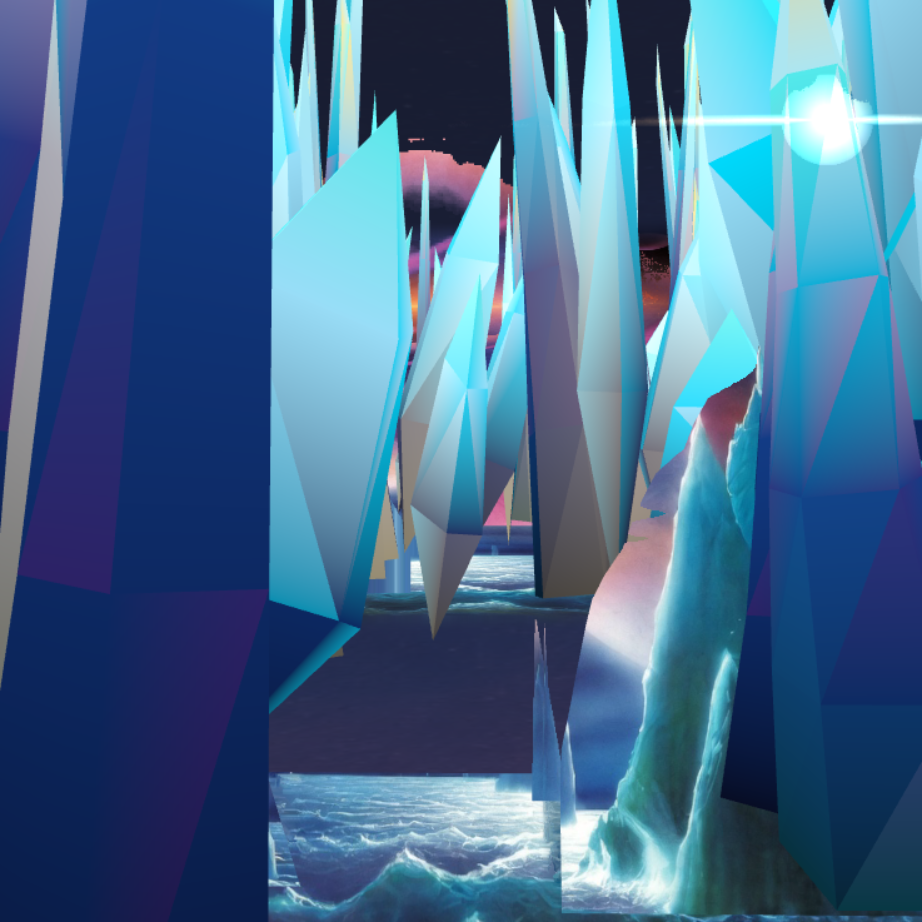
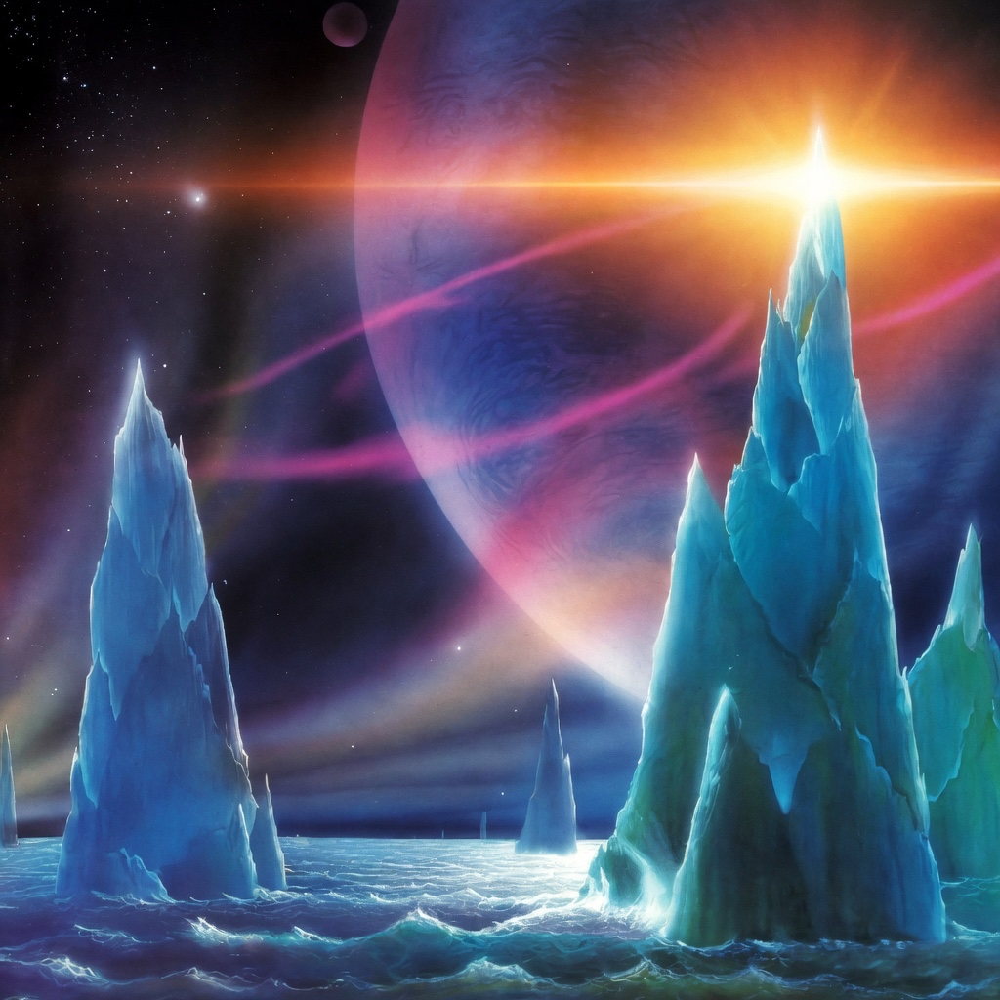

# Living Poster



I clicked on a painting, and then I was inside it.

That's the whole project. Living Poster starts with one piece of art — `reference/poster.jpeg`, a painterly science-fantasy seascape of crystalline spires, an impossibly large planet, magenta ribbons of light, and a luminous alien sea — shown flat and full-screen, exactly as it is. Press ENTER and it awakens: the surface shimmers, the paint starts to melt and separate by depth, the camera pushes through the canvas, and a world builds itself ahead of you out of the poster's own landmarks. Then you land, and you can walk around in it. Slowly. It's a painting, not an action game.

The rule I worked under the whole time, from `PROJECT_CONTEXT.md`: **preserve the painting before pursuing realism.** If a technically realistic 3D treatment fought the look of the poster, the poster won. This is an explorable painting, not a simulation of an alien planet.



## What actually happens

The full experience (the **LIVING POSTER** tab) runs as one continuous pipeline in `src/livingPoster.js`:

1. **Poster** — the untouched painting, pixel-registered to the screen. At the starting camera pose, the 3D version and the flat image are meant to be indistinguishable.
2. **Awakening** — a localized cyan shimmer, the ribbons start breathing, the horizon flare blooms, and painted flecks lift off the surface.
3. **Melt** — a GPU curl-noise melt shader (`src/shaders/paintMeltShader.js`) pulls the image apart by semantic layer — water, crystals, ribbons, sky separate at different rates — while brushstroke particles (`src/effects/brushstrokeParticles.js`) stream past the camera to sell crossing the canvas.
4. **Threshold** — the camera crosses the canvas plane. The flat painting is now behind you.
5. **World generation** — a corridor flight while world chunks construct themselves ahead of the lens (`src/world/worldStreamer.js`): haze → floating painted fragments → silhouettes → low-poly geometry → painterly texture. The chunks are named for what's in them: Gateway, Near Sea, Mid Needles, Atmosphere.
6. **Arrival, then exploration** — you settle into a rest viewpoint, and from there it's WASD + mouse look in a bounded painterly world. Movement is deliberately slow and the look angles are tight, because wider angles would show you the edges of the painting. No jumping, flying, or head-bob. It's a walk, not a traversal system.

The landmarks are the poster's own, kept recognizable on purpose: the Western Sentinel and the Solar Citadel (the big crystal formations), the Midnight Needle, the Umbral Giant (that enormous planet — it stays enormous), the Solstice Flare at the horizon, the magenta Aurora Veil ribbons, and the Abyssal Sea. The full visual and spatial breakdown I worked from is in `POSTER_ANALYSIS.md` — composition, depth interpretation, color and light study, occlusion, and the fidelity risks ranked.

## Run it

```bash
npm install
npm run dev
```

Vite serves it on port 5173. Then:

- Pick the **LIVING POSTER** tab for the full experience and press **ENTER**.
- After arrival: **WASD + mouse** to look and move.
- Keys **1–6** switch to the individual prototype labs. Each prototype also has its own panel of controls, sliders, and diagnostic views.
- **R** restarts, **H** hides the development UI, **P** toggles the FPS HUD in the Living Poster panel, **M** pauses, **G** shows world-generation debug colors, **C** shows chunk bounds, **T** retries the melt.
- `npm run build` and `npm run preview` work as usual for Vite.

It's also deployed on GitHub Pages: **https://cyb3rcricket.github.io/Living-Poster/**

## The prototypes — how it got here

This repo is the lab, not just the final piece. Six prototype iterations are kept in `src/prototype01.js` through `src/prototype06.js`, each with its own notes file, because each one answered a different question and I wanted the dead ends visible.

- **Prototype 01 — Depth Awakening** (`PROTOTYPE_01_NOTES.md`). Can a flat image gain depth without stopping looking like itself? A generated depth map over five spatial planes, a 320×320 subdivided mesh displaced in a custom shader, and a camera calibrated so that at the start the match to the poster is pixel-for-pixel. It also compared mesh displacement against parallax occlusion mapping side by side.
- **Prototype 02 — Independent Proxy Reconstruction** (`PROTOTYPE_02_NOTES.md`). Instead of displacing the image, segment it into seven layers — deep sky, ribbons, Sentinel, Citadel, needles, water, flare — synthesize the hidden regions behind each one, and rebuild each layer as its own proxy geometry at its own depth. Its conclusion was to combine this with Prototype 01, not pick one.
- **Prototype 03 — Invisible Handoff** (`PROTOTYPE_03_NOTES.md`). The hard problem: switching from "flat poster with depth tricks" to "actual spatial scene" without the viewer seeing the seam. A staged state machine — flat → early awakening → handoff window → spatial unlock — with automated landmark-drift telemetry to measure whether the landmarks stayed registered during the swap.
- **Prototype 04 — Solar Citadel Volumetric Reconstruction** (`PROTOTYPE_04_NOTES.md`). Take one landmark and do it properly in volume. The Citadel got a real mesh, projective texturing from the canonical camera so the front still reads as the painting, and a synthesized painterly texture for the flanks the poster never shows. The notes also record, honestly, where the illusion breaks when you push the camera too far.
- **Prototype 05 — Painted Ocean Spatial Reconstruction** (`PROTOTYPE_05_NOTES.md`). The same treatment for the sea: projective painted water, four depth profiles tested against the poster, horizon and Citadel-contact handling, and a follow-up (05B) with a sea-only asset that was verified pixel-by-pixel so inpainting repairs didn't quietly repaint the original water.
- **Prototype 06 — First Controlled Journey.** The pieces assembled into one scripted trip — poster, awakening, handoff, past the Citadel, over the water, to a rest pose — on a rail, with no free movement yet. The Living Poster V1 melt pipeline grew out of this, and the bounded free exploration was added on top of its rest viewpoint.

Supporting code for the final experience lives in `src/livingPosterWorld.js` (ocean continuation, Sentinel and Citadel reuse, ribbons, haze), `src/world/crystalGenerator.js` (a seeded, deterministic crystal generator that sticks strictly to the poster's palette — no greens, no browns, no generic rocks), `src/shaders/` (depth, water, and paint-melt shaders), and `src/livingPosterQuality.js` (resolution/quality scaling).

## Related variant: Ice-Ocean

Living Poster wasn't the only streamed world I built in that stretch. [Ice-Ocean](variants/ice-ocean/) was the sibling experiment: a first-person exploration game where you drift over a dark animated sea beneath a blue-violet planet, steering through seeded ice fields to find pink signal artifacts. Where Living Poster starts from one painting and builds the world out of it, Ice-Ocean generates everything procedurally — no source image, no bounded corridor, travel in every direction for as long as you keep going.

The DNA is the same, which is why it lives here now. Both projects stream the world in chunks around the viewer and dispose of what's left behind — Ice-Ocean in 34-unit chunks in a 5×5 window, generated from one fixed seed (`WORLD_SEED = 271828`), with height-aware collision so you can fly over a spire field but not descend through it. It's the freer, more game-shaped version of the ideas that Living Poster's world streamer uses in a tight corridor. Ice-Ocean is folded in here as a named variant, preserved as-is with its own `package.json` (Three.js `^0.180.0`) — it isn't wired into this repo's build. Its standalone repo is archived.

- [Ice-Ocean variant](variants/ice-ocean/) — full source, its original README, and its `VALIDATION.md` from September 2026

## Tech stack

- JavaScript + [Three.js](https://threejs.org) (`three ^0.186.0`) + Vite
- Custom GLSL shaders throughout — no off-the-shelf water, sky, or transition effects
- Node scripts under `scripts/` for asset generation (depth maps, layer segmentation, Citadel mesh, water masks) and verification captures; `puppeteer-core` drives a headless Chrome for those captures
- One source image: `reference/poster.jpeg` (1024 × 1024). Everything spatial is derived from it

## Honest catch

- **There's no automated test suite and no test CI** (the only workflow in the repo deploys the site to GitHub Pages). `package.json` only defines `dev`, `build`, and `preview`. What exists instead is screenshot-based verification: the scripts under `scripts/` render specific states and capture them (`scripts/test-*.png`, and the labeled sequence in `scripts/v1-verification/` with its `verification-report.json`) so I could compare frames — poster vs. awakened vs. arrived, canonical pose vs. sweeps — and check that the 3D version still matched the painting. That proves the visuals at the poses I captured. It does not prove anything about poses I didn't capture.
- **The exploration is bounded on purpose, and the bounds are tight.** The world only has to hold up inside a small corridor near the poster's own viewpoint, because that's the part I could build faithfully from a single flat image. Step outside that logic and there is no more painting to stand on.
- **This repo is image-heavy.** It's around 90 MB, most of it PNGs: reference art, generated layers, masks, and 48+ verification captures across the prototypes. I kept them because they're the evidence trail for how each decision was checked, but cloning it is not light.
- **The interface is a development lab.** Tabs, telemetry boxes, sliders, and debug views are instrumentation I built to tune the thing, left in because the prototypes are part of the point. It is not a polished product UI, and the default tab is a prototype, not the full experience — pick LIVING POSTER.
- **Naming accumulated.** There are V0 world modules and a V1 melt pipeline side by side in `src/`, plus the six prototypes, because the final experience reuses pieces from several of them. The file headers explain what each module owns; the folder structure tells the history rather than a tidy architecture.
- **One painting means one world.** The pipeline is built around this poster's specific composition, depth map, and semantic layers. Pointing it at a different image isn't a config change — the analysis work in `POSTER_ANALYSIS.md` would have to be redone for the new image first.

## The documents, if you want the deep version

- `PROJECT_CONTEXT.md` — the creative brief: the experience, the visual anchors, and the preserve-the-painting rule
- `POSTER_ANALYSIS.md` — the full breakdown of the artwork: composition, depth, color, occlusion, and success criteria
- `PROTOTYPE_01_NOTES.md` – `PROTOTYPE_05_NOTES.md` — per-prototype technique, parameters, known artifacts, and what each one could and couldn't prove
